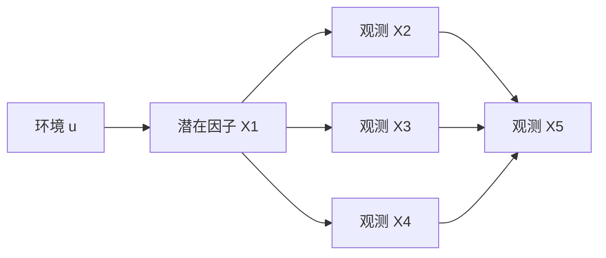

# Causal Latent Recovery

**在已具有测量信息的线性仿真中，iVAE 的条件先验能带来多少额外收益？**

硕士毕业论文项目 · Python / PyTorch · 配对模拟实验与模型评估

本项目比较 VAE、向编码器加入环境信息的 VAE + u，以及使用条件先验的 iVAE。重点是把潜在因子恢复的理论问题转化为可检查的实验，并评估模型收益是否超过观测变量本身已包含的信息。

## 一分钟了解

- **任务**：用四个观测变量恢复一个已知的模拟潜在因子。
- **设计**：4 档样本量 × 5 档噪声 × 4 组路径系数 = 80 个条件；每个条件 10 个种子、3 个模型，共 2,400 次模型拟合。
- **控制变量**：同一条件、同一种子下，三个模型使用同一份数据及相同的数据加载种子。
- **评估**：潜在真值与编码器后验均值的绝对 Pearson 相关；同时保留逐环境指标和单个观测变量基线。
- **发现**：测量噪声和观测结构比模型选择影响更大；iVAE 相对 VAE + u 的额外收益有限。高总体相关不能证明已恢复环境内部的个体差异。



## 方法比较

| 模型 | 编码器 | 潜在先验 | 对照目的 |
|---|---|---|---|
| VAE | q(z ∣ x) | p(z) | 基础模型 |
| VAE + u | q(z ∣ x, u) | p(z) | 单独考察辅助输入 |
| iVAE | q(z ∣ x, u) | p(z ∣ u) | 考察条件先验的额外作用 |

## 先看结果，再运行代码

[80 个条件的结果表](results/table.csv) · [逐次拟合结果](results/model_comparison_raw.csv) · [模型汇总](results/model_comparison_summary.csv) · [单变量基线](results/observed_baselines.csv)

示例：系数 A、噪声 0.35、每环境 100 个样本，10 个种子的均值 ± 标准差：

| VAE | VAE + u | iVAE | 最佳单变量 X4 |
|---|---|---|---|
| 0.970 ± 0.004 | 0.970 ± 0.004 | 0.968 ± 0.013 | 0.976 ± 0.002 |

这个条件说明：复杂模型并不自动优于一个信息充分的观测指标。完整结论需要结合所有条件查看。

## 运行

建议使用 Python 3.10 或更新版本。原始运行环境未提供依赖锁文件，下列依赖需要在目标环境验证。

```bash
python -m venv .venv
source .venv/bin/activate
pip install -r requirements.txt
python smoke.py
```

`smoke.py` 在 CPU 上对三个模型各训练两轮，只检查训练和评估路径。完整网格会执行 2,400 次拟合，请先检查 `train.py` 顶部配置：

```bash
python train.py
python make_table.py
```

完整训练写入 `runs/full/`，按已完成条件续跑；`make_table.py` 读取仓库已有 `results/`，生成 `tables/table.csv`。它不会自动汇总 `runs/full/`。

## 面向产品工作的启发

这个项目体现的是技术验证前的问题收敛：把宽泛的潜在疾病通路设想缩小为单潜因子恢复任务，再用三种配置区分“加入信息”和“改变模型结构”的收益。对产品决策而言，先检查数据是否提供了足够信息，再判断增加模型复杂度是否值得，是本项目可迁移的经验；它尚未涉及真实用户或业务上线。

## 如何阅读代码

| 文件 | 内容 |
|---|---|
| `dgp.py` | 三环境的线性数据生成过程 |
| `model.py` | 共享 VAE 实现和三个模型配置 |
| `train.py` | 配对训练、恢复指标、网格实验与结果保存 |
| `make_table.py` | 由已有结果生成比较表 |
| `smoke.py` | 新增的最小运行检查 |

## 解释边界

这是合成数据研究，评估发生在训练所用数据上，不是独立测试集性能。不同样本量使用固定 epoch，优化步数不相等。总体相关同时受到环境间均值差异影响；它不能单独证明可识别性，也不能证明表示可消除真实数据中的混杂偏倚。当前解码器的条件独立噪声结构与数据中 X5 的依赖关系也存在简化。

## 来源与整理

来源为沈依然硕士研究文件夹中的 `Simulation` 版本。已有 CSV 为历史实验输出，本次整理没有重跑完整实验。新增内容包括 README、最小运行入口和输出目录隔离；原有模型逻辑保持。项目背景为硕士研究，方法基于现有 VAE / iVAE 思路，展示范围为实验实现、对照设计与结果分析。
